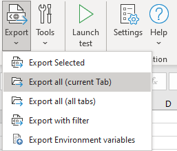
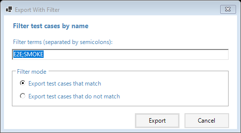

# Export Test data

WebEngine Add-in allows you to export test data and environment variables to XML format, then it can be consumed by test automation solution.

> [!IMPORTANT]
> Test automation solutions built with WebEngine Framework do not read Excel files directly.
> Test data must be exported as XML.
> When a test is launched from Excel, the add-in writes the XML files to the configured export folder and passes them to WebRunner.

In the **Test data** group, you can:
* **Export Selected**: Export the test cases in the selected columns to an XML TestSuite Data file.
* **Export Current Sheet**: Export all test cases of the active data sheet. By default, the XML file has the same name as the current sheet.
* **Export With Filter**: Export test cases matching include/exclude terms.
For example, to execute tests whose name contains "E2E", use `E2E` as the filter:
 
* **Export Environment**: Export environment variables from the sheet named `ENV` and generate `ENV.xml`.

