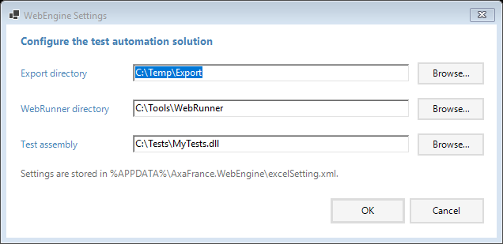

# Settings

## Settings dialog
Before launching tests from WebEngine Add-in for Excel, configure the add-in and your test automation solution.

Open the **WebEngine** tab and click **Settings**.

## Parameters

* `Export folder`: Folder where `ENV.xml` and the test data XML files are written.
* `WebRunner folder`: Folder containing `WebRunner.exe` (for .NET test projects) or `WebRunner.jar` (for Java test projects).
* `Test assembly`: Compiled test project (`.dll`) or Java test archive (`.jar`).
* `Default browser`: Browser preselected when the launch dialog opens.
* `Excluded tabs`: Worksheets ignored by export commands (separated by semicolons). Defaults to `NOTE;DATA_TABLE;PARAMS;ENV`.

> [!NOTE]
> WebEngine automatically selects the runner:
> For a .NET test project it launches `WebRunner.exe`; for a Java test project it launches
> `WebRunner.jar` with the bundled JRE when available.

Settings are stored in `%APPDATA%\AxaFrance.WebEngine\excelSetting.xml`, the same location used by the former VSTO add-in.
They are reused the next time Excel starts.

If you work with another test automation solution, update the paths and the test assembly.
